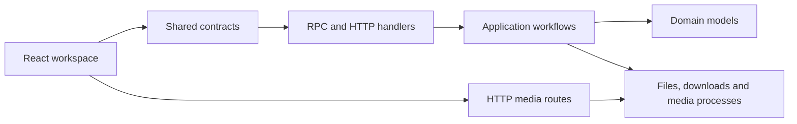

# Architecture and source map

The React client sends validated requests to an Express server. Downloads,
extraction and media preparation run in the background while users browse ready
sessions. HTTP sessions are temporary; torrents keep metadata and payloads
across restarts. See [storage](../guides/storage.md) for lifecycle rules.

## Request flow

`shared/contracts.ts` owns Zod schemas and the oRPC contract. Treat external
data as `unknown` until validation succeeds. Infer transport types from the
schemas rather than maintaining separate client and server definitions.

## Client

| Path under `client/src/`                       | Responsibility                                                  |
| ---------------------------------------------- | --------------------------------------------------------------- |
| `pages/`                                       | App composition.                                                |
| `features/workspace/`                          | Queue state, layout, sessions and dialogs.                      |
| `features/player/`                             | Quality selection, seeking and HLS playback.                    |
| `components/Workspace/`, `components/Preview/` | Workspace and media views.                                      |
| `hooks/`                                       | Selection, keyboard behavior, caching and playback controllers. |
| `services/`                                    | Validated HTTP and typed RPC clients.                           |
| `styles/`                                      | Theme tokens and shared styles. `styles.css` imports them.      |

TanStack Query owns server state. The file tree renders a window of rows for
large collections. Resizable panels compose the desktop workspace.

## Server

| Path under `server/`                | Responsibility                                       |
| ----------------------------------- | ---------------------------------------------------- |
| `index.ts`, `runtimeComposition.ts` | Process entry and dependency wiring.                 |
| `bootstrap/`                        | Express setup, startup restoration and shutdown.     |
| `domain/`                           | Job, session, file-tree and error models.            |
| `application/`                      | Download, torrent, extraction and session workflows. |
| `handlers/`, `rpc/`                 | HTTP media routes and RPC adapters.                  |
| `infrastructure/`                   | File, archive, network and media operations.         |
| `media/`                            | Rendition, playlist and process-limiting helpers.    |
| `repositories/`                     | In-memory state and SQLite retained-torrent storage. |
| `services/`, `realtime/`            | Segmented transfers and progress delivery.           |
| `tui/`                              | Interactive terminal dashboard.                      |

Domain code has no HTTP or filesystem dependencies. Application workflows use
typed dependencies; adapters handle I/O. Fallow checks these import boundaries.

## Media and storage

Direct playback serves the original file. Remuxing changes its container;
transcoding creates HLS renditions. Long videos use eight-second windows with
four-second segments. Requests for the same window share work, and obsolete
requests release their consumers without stopping other viewers.

Media work shares a bounded process pool. Retained videos prepare in the
background while interactive requests receive priority. Generated media has a
cross-session cache budget; cleanup protects active readers and drains jobs.
File routes validate paths against their owning session, including real paths.

## Tests and delivery

Unit and component tests live beside source files. `tests/` contains integration,
E2E, review and benchmark suites plus fixtures. The [testing guide](testing.md)
lists commands. Production output is `dist/` for the client and `build/` for
server and shared modules. Neither output belongs in Git.
